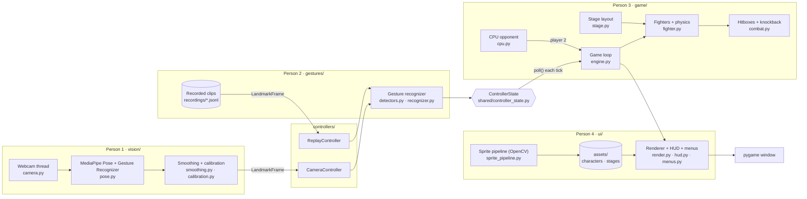

# Smash CV

A Smash Bros-style fighter where your laptop camera is the controller. Punch at
the camera and your character punches. Lean to run, throw your hands up to
jump.

## Setup

Python 3.10+.

```bash
python -m venv .venv
source .venv/bin/activate          # Windows: .venv\Scripts\activate
pip install -r requirements.txt
python tools/download_models.py    # MediaPipe pose + gesture models into models/
```

## Run

```bash
python main.py overlay                     # camera debug view: skeleton, gestures, live ControllerState
python main.py calibrate --name <you>      # sit neutral for a few seconds; saves calibration/<you>.json
python main.py play --calibration <you>    # you (camera) vs CPU
python main.py play --replay recordings/jab/<file>.jsonl   # a recording vs CPU, no camera needed

python -m gestures.recorder --label jab --player <you>      # record a labeled gesture clip
python -m ui.sprite_pipeline sheet.png assets/characters/<name>/<action>   # slice a sprite sheet
pytest                                     # tests, no camera needed
```

Close the game window to quit. In the overlay and recorder windows, press `q`.

## Architecture



Data moves left to right. The camera thread runs at camera speed (about 30
fps) and the game loop at 60 fps. Each tick, the game asks every controller
for its latest `ControllerState`.

| Type | Defined in | Produced by | Consumed by |
| --- | --- | --- | --- |
| `LandmarkFrame` | `shared/landmarks.py` | `vision/pose.py`, recordings | `gestures/` |
| `Calibration` | `vision/calibration.py` | `main.py calibrate` | `gestures/detectors.py` |
| `ControllerState` | `shared/controller_state.py` | `gestures/recognizer.py`, `game/cpu.py` | `game/` |
| `Fighter.state` (animation name) | `game/fighter.py` | `game/` | `ui/render.py` |

The game only ever calls `controller.poll()` and gets a `ControllerState`
(`shared/controller_state.py`). That file is the contract between the vision
side and the game side: **change it only when all four of us agree.**

There is no keyboard controller. For testing, record gestures once and replay
them: `ReplayController` feeds a recording through the same gesture recognizer
a live camera uses.

## Who owns what

| Folder | Owner | What's there | Start here |
| --- | --- | --- | --- |
| `vision/` | Person 1 | Camera thread, MediaPipe wrapper, smoothing, calibration, debug overlay | `TODO(Person 1)` in `vision/pose.py`, `vision/smoothing.py` |
| `gestures/` | Person 2 | Gesture detectors, recognizer (edges and cooldowns), recorder | Stubs at the bottom of `gestures/detectors.py` |
| `controllers/` | Person 1 + 2 | Camera and replay controllers | |
| `game/` | Person 3 | Physics, fighters, combat, stage, CPU, game loop | `TODO(Person 3)` in `game/` |
| `ui/` | Person 4 | Rendering, sprites, HUD, menus, OpenCV sprite pipeline | `TODO(Person 4)` in `ui/` |
| `shared/` | Everyone | The ControllerState contract, landmark types, config | |

Find your work with `grep -rn "TODO(Person 2)" .` and so on.

## What works today (phase 1 starting point)

- Live pose + hand tracking with gesture names, and an overlay showing FPS and latency
- Detectors: lean → `move_x`, duck → `crouch`, both hands up → `jump`, fast wrist → `jab`, both fists → `smash`, fingertip → `pointer`
- Calibration saved per person
- Record and replay gesture clips
- Box fighters on a Battlefield-style stage: running, double jump, jab/smash hitboxes, damage %, knockback that grows with damage, stocks, CPU opponent
- Sprite sheet slicer (background removal + contour detection)

Still stubs: special, up special, shield, grab, taunt, pause detectors; menus;
real sprites; second camera player.

## Conventions

- Work on a branch per feature (`p2/shield-detector`), open a PR, get one review from the other pair.
- Detectors read `LandmarkFrame`s, never the camera, so they can be tested on recordings. Add a test for each new detector in `tests/`.
- Measure distances in shoulder widths (from calibration), not pixels, so thresholds work at any distance from the camera.
- Commit landmark recordings (`.jsonl`) to `recordings/<label>/`. They are our test data. Don't commit raw video.
- `calibration/` and `models/` are per laptop and ignored by git.

## Assets

Sprites from The Spriters Resource and stage art are fine for a class demo.
Don't publish Nintendo assets publicly. Put sprite frames in
`assets/characters/<character>/<state>/frame_XX.png`. State names: idle, run,
jump, fall, crouch, shield, hurt, taunt, jab, smash, special, up_special, grab.
