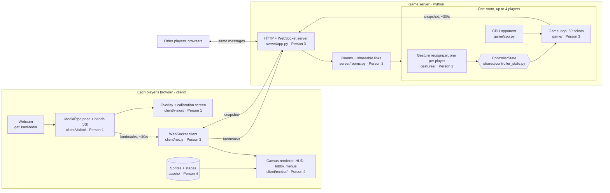

# Smash CV

An online Smash Bros-style fighter where your laptop camera is the controller.
Punch at the camera and your character punches. Lean to run, throw your hands
up to jump. Friends join a match from their own computers through a shared
link.

## Setup

Python 3.10+.

```bash
python -m venv .venv
source .venv/bin/activate          # Windows: .venv\Scripts\activate
pip install -r requirements.txt
python tools/download_models.py    # MediaPipe pose + gesture models into models/
```

## Run

These commands run the local, single-computer harness. The online server and
browser client are not built yet (see Architecture).

```bash
python main.py overlay                     # camera debug view: skeleton, gestures, live ControllerState
python main.py calibrate --name <you>      # sit neutral for a few seconds; saves calibration/<you>.json
python main.py play --calibration <you>    # you (camera) vs CPU
python main.py play --replay recordings/jab/<file>.jsonl   # a recording vs CPU, no camera needed

python -m gestures.recorder --label jab --player <you>      # record a labeled gesture clip
python -m ui.sprite_pipeline sheet.png assets/characters/<name>/<action>   # slice a sprite sheet
pytest                                     # Python tests, no camera needed
```

Browser renderer demo, with a fake server and no camera:

```bash
python -m http.server 8000                 # from the repo root, then open http://localhost:8000/client/render/demo.html
cd client && npm test                      # JavaScript tests (Node 18+)
```

Close the game window to quit. In the overlay and recorder windows, press `q`.

## Architecture

Smash CV is an online multiplayer game. One player creates a room and shares
the link (`https://<host>/room/ABCD`). Each player opens it in their own
browser and plays with their own laptop camera.



**What happens in one round trip**

1. The browser reads the camera and runs MediaPipe locally. Video never leaves the player's laptop.
2. The browser sends that frame's landmarks (about 3 KB of JSON) over a WebSocket.
3. The server runs that player's gesture recognizer, which turns landmarks into a `ControllerState`.
4. The room's game loop applies every player's `ControllerState`, steps physics and resolves hits, 60 times a second.
5. About 30 times a second, the server sends every browser a snapshot of where each fighter is and what it is doing.
6. Each browser draws the snapshot, smoothing between the last two so movement looks fluid.

**Why it's built this way**

- **Landmarks, not video, go over the network.** Landmarks are about 100 KB/s per player, video would be several MB/s, and nobody's camera feed leaves their computer.
- **Gesture recognition runs on the server.** Person 2's Python detectors, tests and recorded clips work unchanged, and the server decides what every player did, so no browser can fake an input.
- **The server owns the game.** All players see the same match. The server runs the existing `game/` code without opening a window.
- **The link must be HTTPS.** Browsers only allow camera access on `https://` pages (or `localhost`). For a demo, run the server on one laptop and share it through a tunnel such as Cloudflare Tunnel or ngrok, or deploy it to a host like Fly.io or Render.

### Messages

All messages are JSON over one WebSocket per player. Server messages are built by `shared/protocol.py` and read by `client/render/protocol.js`. Like `ControllerState`, change them only when all four of us agree.

| Direction | Message | Contents | When |
| --- | --- | --- | --- |
| browser → server | `join` | room code, name, character | Opening the link |
| browser → server | `calibrate` | about 2 s of landmark frames while sitting neutral | Before the first match |
| browser → server | `landmarks` | one `LandmarkFrame` | Every camera frame |
| server → browser | `match_start` | stage layout (ground, platforms, background), players and characters | When a match begins |
| server → browser | `lobby` | room code, link, host, stage, and each player's name, character, ready and connected | When anyone joins, leaves or picks |
| server → browser | `snapshot` | tick, server time, and for each fighter: id, character, x, y, body size, facing, animation state, damage %, stocks, shield, active hitbox | About 30 times a second |
| server → browser | `event` | tick and server time, plus: `hit` (attacker, target, attack, damage, shielded, where it landed), `ko` (player, stocks left, where they left), or `game_over` (winner, or null for a draw) | When it happens |

**Keeping both sides in sync.** `shared/protocol_examples/` holds one real
example of every server message, built from the actual game. Python tests check
the server still produces messages shaped like them, and JavaScript tests check
the renderer can draw them. If you rename or remove a field, a test on one side
fails right away. To change a message on purpose, run
`python tools/update_protocol_examples.py`, update `client/render/protocol.js`
to match, and tell the team.

### Data types

| Type | Defined in | Produced by | Consumed by |
| --- | --- | --- | --- |
| `LandmarkFrame` | `shared/landmarks.py` | MediaPipe in the browser, recordings | `gestures/` on the server |
| `Calibration` | `vision/calibration.py` | the `calibrate` message | `gestures/detectors.py` |
| `ControllerState` | `shared/controller_state.py` | `gestures/recognizer.py`, `game/cpu.py` | `game/` |
| Snapshot | `shared/protocol.py` | `server/` from `game/` | `client/render/` |

### Testing without a camera

There is no keyboard controller. `ReplayController` feeds recorded clips
through the same gesture recognizer the server uses, so detectors and game
logic can be tested with `pytest` or the local `main.py` harness. A replay
client that sends a recording over the WebSocket can stand in for a second
player when testing the server alone.

## Who owns what

| Area | Owner | Runs where | What's there |
| --- | --- | --- | --- |
| `client/vision/` | Person 1 | Browser (JavaScript) | Camera, MediaPipe for the web, smoothing, overlay, calibration screen |
| `vision/` | Person 1 | Local harness (Python) | Python version of the same, used by `main.py` and the recorder |
| `gestures/` | Person 2 | Server (Python) | Detectors, recognizer (edges and cooldowns), clip recorder |
| `server/`, `client/net.js` | Person 3 | Server + browser | WebSocket server, rooms and links, the snapshot loop |
| `game/` | Person 3 | Server (Python) | Physics, fighters, combat, stage, CPU |
| `client/render/` | Person 4 | Browser (JavaScript) | Canvas renderer, HUD, lobby, character select, pointer menus |
| `ui/sprite_pipeline.py`, `assets/` | Person 4 | Offline tool (Python) | OpenCV sprite slicing, sprites and stages |
| `shared/` | Everyone | Both | `ControllerState`, landmark types, message protocol |

Find your work with `grep -rn "TODO(Person 2)" .` and so on.

### Moving from the current code

The code in the repo today is the single-computer version: everything runs in
one Python process and draws with pygame. Most of it carries over as is.

| Today | Online version |
| --- | --- |
| `gestures/`, `game/` | Unchanged, run on the server |
| `vision/` (Python MediaPipe) | Ported to `client/vision/` with MediaPipe for the web. The Python version stays for the recorder and local testing |
| `ui/render.py`, `ui/hud.py` (pygame) | Ported to `client/render/` (HTML canvas) |
| `controllers/camera_controller.py` | Replaced by the server feeding each player's landmarks to their recognizer |
| `main.py` | Kept as a local harness for testing without the server |

## What works today (phase 1 starting point)

- Live pose + hand tracking with gesture names, and an overlay showing FPS and latency
- Detectors: lean → `move_x`, duck → `crouch`, both hands up → `jump`, fast wrist → `jab`, both fists → `smash`, fingertip → `pointer`
- Calibration saved per person
- Record and replay gesture clips
- Box fighters on a Battlefield-style stage: running, double jump, jab/smash hitboxes, damage %, knockback that grows with damage, stocks, CPU opponent
- Sprite sheet slicer (background removal + contour detection)

Still stubs: special, up special, shield, grab, taunt, pause detectors; menus;
real sprites.

Browser renderer (`client/render/`): draws `match_start`, `snapshot` and
`event` messages on a canvas: box fighters, smooth movement between snapshots,
damage % and stocks, hit sparks, KO bursts with screen shake, and the "GAME!"
screen. `render/demo.html` runs it against a fake server. The game reports
hits, KOs and game over each tick (`game/events.py`).

Not built yet: the game server, rooms and shareable links, browser camera
tracking, lobby and menus, and sprites in the browser.

## Conventions

- Work on a branch per feature (`p2/shield-detector`), open a PR, get one review from the other pair.
- Detectors read `LandmarkFrame`s, never the camera, so they can be tested on recordings. Add a test for each new detector in `tests/`.
- Measure distances in shoulder widths (from calibration), not pixels, so thresholds work at any distance from the camera.
- Commit landmark recordings (`.jsonl`) to `recordings/<label>/`. They are our test data. Don't commit raw video.
- `calibration/` and `models/` are per laptop and ignored by git.

## Assets

Sprites from The Spriters Resource and stage art are fine for a class demo.
Don't publish Nintendo assets publicly. Put sprite frames in
`assets/characters/<character>/<state>/frame_XX.png`. State names: idle, run,
jump, fall, crouch, shield, hurt, taunt, jab, smash, special, up_special, grab.

Characters and stages are retro pixel art generated by scripts, so they are
easy to tweak and regenerate:

- `assets/characters/<name>/make_sprite.py` draws a 32x44 character (front,
  left and right views) on the shared toolkit in `assets/characters/pixel_sprite.py`.
  `assets/characters/make_roster.py` builds `roster.png`.
- `assets/stages/make_memorial_glade.py` draws Memorial Glade at 640x360, shown
  at 2x. Its platforms must match `battlefield()` in `game/stage.py`;
  `tests/test_stage_art.py` fails if they drift apart.
