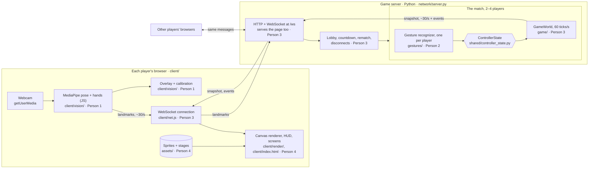

# Smash CV

An online Smash Bros-style fighter where your laptop camera is the controller.
Punch at the camera and your character punches. Lean to run, throw your hands
up to jump. Friends join a match from their own computers through a shared
link.

## Play online

The server and its tests need no camera packages:

```bash
pip install -r requirements-game.txt
python main.py server                     # --stocks N
```

Open the printed link (`http://127.0.0.1:8765/`) in a browser and choose:

- **Play vs CPU:** a private room against a computer opponent. Pick a fighter,
  allow the camera, calibrate, press Ready.
- **Play with friends:** creates a room and a shareable link
  (`…/?room=ABCD`). Friends who open it land in your lobby. Up to 4 players;
  the match starts once at least two are in and everyone is ready.

In the lobby you can switch fighters, and the host (first to join) picks the
stage: Memorial Glade, Gateway, Sather Gate or Soda Hall. One server runs many
rooms at once.

**Playing with friends on other computers.** Browsers only allow the camera on
`https://` pages (or `localhost`), so share an https link to your server, for
example with a tunnel:

```bash
cloudflared tunnel --url http://localhost:8765     # or: ngrok http 8765
python main.py server --public-url https://<the-link-it-printed>/
```

Room links then use the https address.

**Testing alone.** Play vs CPU, or create a friends room and let a bot join
it. The bot plays a recorded clip on loop through the same gesture recognizer
real players use:

```bash
python main.py bot --link 'http://127.0.0.1:8765/?room=ABCD' --replay recordings/<label>/<file>.jsonl --character oski
```

## Setup for camera and vision work

Python 3.10+.

```bash
python -m venv .venv
source .venv/bin/activate          # Windows: .venv\Scripts\activate
pip install -r requirements.txt
python tools/download_models.py    # MediaPipe pose + gesture models into models/
```

## Local tools

```bash
python main.py overlay                     # camera debug view: skeleton, gestures, live ControllerState
python main.py calibrate --name <you>      # sit neutral for a few seconds; saves calibration/<you>.json
python main.py play --calibration <you>    # single-computer harness: you (camera) vs CPU in a pygame window
python main.py play --replay recordings/jab/<file>.jsonl   # a recording vs CPU, no camera needed

python -m gestures.recorder --label jab --player <you>      # record a labeled gesture clip
python -m ui.sprite_pipeline sheet.png assets/characters/<name>/<action>   # slice a sprite sheet
pytest                                     # Python tests, no camera needed
cd client && npm test                      # JavaScript tests (Node 18+)
```

Renderer demo with a fake server and no camera: run `python -m http.server 8000`
from the repo root and open http://localhost:8000/client/render/demo.html.
Browser vision debug page: http://localhost:8000/client/vision/index.html.

Close a pygame window to quit. In the overlay and recorder windows, press `q`.

## Architecture

One server hosts many rooms. Each room is one lobby and match: one player vs
the CPU, or 2–4 friends who joined through the room's link. Each player plays
in their own browser with their own laptop camera.



**What happens in one round trip**

1. The browser reads the camera and runs MediaPipe locally. Video never leaves the player's laptop.
2. The browser sends that frame's landmarks (about 3 KB of JSON) over the WebSocket.
3. The server runs that player's gesture recognizer, which turns landmarks into a `ControllerState`.
4. `GameWorld` applies every player's `ControllerState`, steps physics and resolves hits, 60 times a second.
5. About 30 times a second, the server sends every browser a snapshot, plus an event for each hit, KO, disconnect or game over.
6. Each browser draws the snapshot slightly in the past, sliding between snapshots so movement looks smooth.

**Why it's built this way**

- **Landmarks, not video, go over the network.** About 100 KB/s per player instead of several MB/s, and nobody's camera feed leaves their computer.
- **Gesture recognition runs on the server.** Person 2's Python detectors, tests and recordings work unchanged, and browsers can't send inputs at all, so nobody can fake a move.
- **The server owns the game.** Everyone sees the same match. `GameWorld` never touches a screen, camera or clock, so it's deterministic and easy to test.
- **The link must be https** for the camera to work (see Play online).

### Messages

JSON over one WebSocket per player.

| Direction | Message | Contents | When |
| --- | --- | --- | --- |
| browser → server | `hello` | protocol version, name, character, mode (`cpu`/`friends`), room code from a link or null to create a room | First message |
| browser → server | `calibrate` | center_x, shoulder_y, nose_y, shoulder_width (computed in the browser) | Any time before or during the match |
| browser → server | `character` | fighter id | In the lobby, to switch fighter |
| browser → server | `stage` | stage id | In the lobby; only the host's choice counts |
| browser → server | `ready` | true or false | In the lobby |
| browser → server | `landmarks` | one `LandmarkFrame` | Every camera frame while playing |
| browser → server | `rematch`, `leave` | nothing | After game over; when leaving |
| server → browser | `welcome` | your player id, room code, shareable link, mode | After `hello` |
| server → browser | `lobby` | room, link, host, stage id, phase (`lobby`/`countdown`/`playing`/`finished`), capacity, mode, and each player's name, character, ready, connected, rematch and whether it's the CPU | Whenever any of that changes |
| server → browser | `match_start` | stage layout and background, players and characters, countdown seconds | When everyone is ready |
| server → browser | `snapshot` | tick, match time, and for each fighter: id, character, x, y, body size, facing, animation state, damage %, stocks, shield, life_id, invulnerable, active hitbox | About 30 times a second |
| server → browser | `event` | tick and match time, plus `hit` (attacker, target, attack, damage, shielded, where it landed), `ko` (player, stocks left, where they left), `disconnect` (player) or `game_over` (winner, or null for a draw) | When it happens |
| server → browser | `error` | what went wrong | Then the server closes the connection |

Browser messages are validated in `network/protocol.py`. Server messages are
built by `shared/protocol.py` and read by `client/render/protocol.js`. Change
them only when all four of us agree, and bump `VERSION` in
`network/protocol.py` and `PROTOCOL_VERSION` in `client/net.js` together.

**Keeping both sides in sync.** `shared/protocol_examples/` holds one real
example of every server message, built from the actual game. Python tests check
the server still produces messages shaped like them, and JavaScript tests check
the renderer can draw them. If you rename or remove a field, a test on one side
fails right away. To change a message on purpose, run
`python tools/update_protocol_examples.py`, update `client/render/protocol.js`
to match, and tell the team.

### Data types

| Type | Defined in | Produced by | Consumed by |
| --- | --- | --- | --- |
| `LandmarkFrame` | `shared/landmarks.py` | MediaPipe in the browser, recordings | `gestures/` on the server |
| `Calibration` | `vision/calibration.py` | the `calibrate` message | `gestures/detectors.py` |
| `ControllerState` | `shared/controller_state.py` | `gestures/recognizer.py`, `game/cpu.py` | `game/` |
| Events (`Hit`, `KO`, `Disconnect`, `GameOver`) | `game/events.py` | `GameWorld` each tick | `shared/protocol.py` → browsers |
| Snapshot | `shared/protocol.py` | `GameWorld.snapshot()` | `client/render/` |

### Testing without a camera

There is no keyboard controller. Recorded clips go through the same gesture
recognizer the server uses: `ReplayController` for local play and tests, and
`python main.py bot --replay ...` as a stand-in online player.
`tests/test_network.py` runs the real server over localhost WebSockets with bots
standing in for browsers.

## Who owns what

| Area | Owner | Runs where | What's there |
| --- | --- | --- | --- |
| `client/vision/` | Person 1 | Browser (JavaScript) | Camera, MediaPipe for the web, smoothing, overlay, calibration |
| `vision/` | Person 1 | Local tools (Python) | Python version of the same, used by `main.py` and the recorder |
| `gestures/` | Person 2 | Server (Python) | Detectors, recognizer (edges and cooldowns), clip recorder |
| `network/`, `client/net.js` | Person 3 | Server + browser | WebSocket server, rooms (vs CPU and friends), lobby, rematch, disconnects, message validation, test bot |
| `game/` | Person 3 | Server (Python) | `GameWorld`: physics, fighters, combat, stage, events, CPU |
| `client/render/`, `client/index.html`, `client/characters.js` | Person 4 | Browser (JavaScript) | Canvas renderer, HUD, effects, join/lobby/match screens |
| `assets/`, `ui/` | Person 4 | Offline tools + local pygame harness | Pixel art scripts, sprites, stages, OpenCV sprite slicing |
| `shared/` | Everyone | Both | `ControllerState`, landmark types, message formats and examples |

Find your work with `grep -rn "TODO(Person 2)" .` and so on.

## What works today

- **Online play:** play vs CPU, or create a room and share its link with up to 3 friends. Pick a fighter, calibrate, ready up, countdown, match, game over, rematch. Disconnects remove that fighter; the last one standing wins.
- **Browser camera tracking** with MediaPipe, sending landmarks to the server.
- **Detectors:** lean to move, duck to crouch, both hands up to jump, fast wrist to jab, both fists to smash, special, up special, shield, grab, taunt, pause (ignored online), and a fingertip pointer.
- **Game:** running, double jump, platform drop-through, all five attacks, damage %, knockback that grows with damage, stocks, respawn invulnerability, simultaneous hits that trade.
- **Browser renderer:** stage art, character sprites with a pose for every action (jab, smash, special, up special, grab, jump, hurt, taunt...), smooth movement between snapshots, damage % and stocks, hit sparks, KO bursts, the "GAME!" screen.
- **Lobby:** stage picker (host) and fighter switching.
- **Art:** five retro pixel characters with generated action poses, and four stages: Memorial Glade, Gateway, Sather Gate and Soda Hall.

Not built yet: hand-drawn multi-frame animations, pointer-driven menus, sound.

## Conventions

- Detectors read `LandmarkFrame`s, never the camera, so they can be tested on recordings. Add a test for each new detector in `tests/`.
- Measure distances in shoulder widths (from calibration), not pixels, so thresholds work at any distance from the camera.
- Commit landmark recordings (`.jsonl`) to `recordings/<label>/`. They are our test data. Don't commit raw video.
- `calibration/` and `models/` are per laptop and ignored by git.

## Assets

Characters and stages are retro pixel art generated by scripts, so they are
easy to tweak and regenerate:

- `assets/characters/<name>/make_sprite.py` draws a 32x44 character (front,
  left and right views) on the shared toolkit in `assets/characters/pixel_sprite.py`.
  `assets/characters/make_roster.py` builds `roster.png`. Playable characters are
  listed in `client/characters.js` and `CHARACTERS` in `network/protocol.py`.
- `assets/characters/poses.py` generates a pose for every game state from each
  character's side view (each character names its sleeve and hand colors), and
  `pixel_sprite.save()` writes `<character>/<state>/frame_XX.png`,
  `sprites.json` (frame counts, read by the browser) and `actions.png`.
- `assets/stages/make_<stage>.py` draws each stage at 640x360, shown at 2x, on
  the shared toolkit in `assets/stages/stage_art.py`. Platforms come from
  `STAGES` in `game/stage.py`; `tests/test_stage_art.py` fails if art and
  platforms drift apart. To add a stage: add its layout to `STAGES`, its id to
  `network/protocol.py` and `client/stages.js`, and a `make_<stage>.py`.

Sprite frames go in `assets/characters/<character>/<state>/frame_XX.png`. State
names: idle, run, jump, fall, crouch, shield, hurt, taunt, jab, smash, special,
up_special, grab. UC Berkeley names and landmarks are fine for a class project;
check with the people portrayed before publishing, and keep Oski and university
logos out of anything public or commercial.
