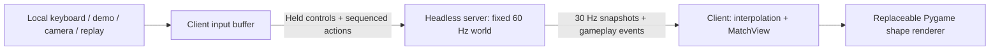

# Person 3: playable framework prototype

> **Update (merged into main, Nov 3):** this prototype was adapted to the team's
> browser plan. The server now speaks WebSockets and serves the play page, so
> players join from a link; browsers send landmarks and the server runs the
> gesture recognizer for each player, replacing the `input` message. Snapshots
> and events use `shared/protocol.py`. The Pygame client, the keyboard/demo
> controllers and `shared/game_state.py` were removed; `python main.py bot`
> replaces the demo input. `GameWorld`, the lobby, countdown, rematch,
> disconnect handling, stale-input and rate limits are unchanged in spirit.
> The README is the current reference; the rest of this page describes the
> original prototype.

The current scope is an authoritative server, independent Python/Pygame clients,
and simple shape rendering. Implement movement and three attacks; defer detailed
mechanics while Persons 1/2 finish vision and Person 4 builds presentation.

## Implemented system

- One configurable 2–4 player lobby and match per server; auto-ready clients,
  countdown, stocks, win/draw, rematch voting, and disconnect forfeits.
- Movement, double jump, crouch/platform drop-through, jab, heavy (`smash`), and
  a longer-range melee special. No projectile subsystem is needed for this slice.
- Server-owned collision, damage, hitstun, knockback, respawn, and match results.
  Camera inference and rendering stay on each laptop.
- Versioned, size-limited JSON over asyncio TCP streams. Session-assigned
  identities, validated controls, duplicate action suppression, bounded queues,
  stale-control neutralization, and isolated per-client writers.
- Independent controller polling, network sends, and rendering. Actions survive
  the 60 Hz polling / 30 Hz send boundary. Interpolation snaps on respawn.
- No shared `ControllerState` changes and no edits to Person 4's `ui/` modules.
  The optional keyboard controller is a development input for this prototype.

## Module responsibilities

| Module | Responsibility |
| --- | --- |
| `game/engine.py` | `GameWorld.step(inputs)` and `snapshot()`; no camera, UI, wall clock, sockets, or display initialization. `Game` retains the original local-play adapter. |
| `game/fighter.py`, `combat.py`, `stage.py` | Existing physics and basic combat, per-target hits, complete life reset, configurable spawns, terminal elimination/draw handling |
| `shared/game_state.py` | Immutable, JSON-friendly world and fighter views; fixed world coordinates, feet-based y, state timing, life IDs |
| `network/protocol.py` | Framing, protocol version, message/field limits, strict input validation |
| `network/server.py` | Lobby, sessions, fixed-tick scheduler, input queues, authoritative world, snapshots/events, disconnects/rematches |
| `network/client.py` | Async connection, commands, input sending, state reception, gameplay event queue |
| `client/input_buffer.py`, `interpolation.py` | Preserve input edges and construct interpolated read-only views |
| `client/runtime.py` | Local controller adapter, cooperative frame pacing, main-thread Pygame event/render loop |
| `client/render.py` | Temporary shapes/HUD/debug hitboxes; replaceable by Person 4 |
| `controllers/development.py` | Optional keyboard and snapshot-driven demo inputs |
| `main.py` | Server/client CLI plus existing overlay, calibration, local play |

## Person 4 handoff

The renderer consumes a `MatchView` plus lobby data and the local player ID.
Fighter views include position, dimensions, facing, animation state/time,
damage, stocks, active hitbox, respawn generation (`life_id`), and invulnerability.
Stage views contain fixed world dimensions and platform rectangles.

Replace `PrototypeRenderer.draw()` or adapt its call site in `client/runtime.py`.
No simulation or network changes are needed to load sprites, draw a different
HUD, or add menu screens. Window resizing letterboxes the fixed world; visual
assets must not change collision geometry.

`NetworkClient.ready()`, `.rematch()`, `.lobby`, `.latest`, and `.events` are the
integration hooks. Events have stable IDs within a match and include hits,
stock loss, respawn, and disconnects. Results come from the final `MatchView`.
Person 4 can implement effects and screen transitions against those hooks.

## Testing and launch

See the root README for complete commands. Start `python main.py server`, then
launch two clients in separate terminals with `python main.py client --name NAME`.
For solo testing, make the second client `--input demo`. For LAN clients, bind
the server to `0.0.0.0` and connect clients to the host's actual LAN IP.

Run `python -m pytest -q`. Tests cover headless simulation, repeatable scripted
inputs, snapshot serialization, attack trades, lifecycle/reset behavior, wire
validation/framing, one-shot input delivery, interpolation, and real localhost
connections with two/four clients, rematches, and disconnects. Socket tests need
permission to bind localhost. Models and live cameras are unnecessary for these
checks.

## Deferred work

Shields, grabs/throws, up-special recovery, character-specific kits, detailed
assets/menus/effects, multiple rooms, matchmaking, rollback/prediction, and
internet hosting are outside this prototype. TCP can delay fresh data during
packet loss; start with LAN testing and measure responsiveness before choosing
more complex transport/prediction work.

Remaining team integration is to exercise the camera input on each person's
laptop and connect Person 4's asset renderer. This implementation keeps their
existing modules and shared controller contract available for that work.
